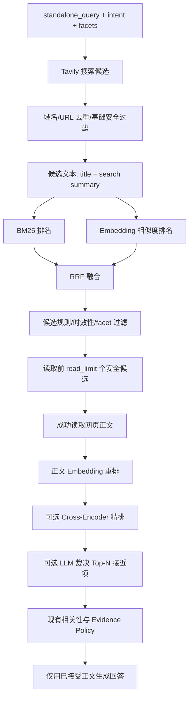

# 在线网页混合召回与分层重排序设计

## 目标

提升在线网页研究的相关性与时效性：不再主要依赖搜索服务返回顺序，而是在安全候选范围内进行 BM25 + 向量 RRF 召回重排、正文级 Cross-Encoder 重排，并按需使用受限 LLM reranker。该设计不降低现有 SSRF、域名、正文质量、required facets、时效性或 evidence policy 的门槛。

## 现状与问题

当前 `WebSearchTool` 接收 Tavily 候选后，只做域名过滤、Python 版本过滤、URL 去重及中文路径偏好。`GraphAgentRunner._deduplicate()` 对候选使用确定性启发式排序，再在 `_read_sources()` 中读取前 `read_limit` 个来源。`_evidence_rejection_reason()` 在正文读取后可拒绝低相关或过期内容，但错误候选仍可能优先占用有限读取预算。

项目已有 `evaluation/bm25.py`、`evaluation/embeddings.py` 和 `evaluation/hybrid.py:rrf_fuse()`，但它们仅服务离线评测，未进入在线 web 路径。`sentence-transformers` 已是可选 extra；目前没有 Cross-Encoder 或 reranker 的运行时抽象。

## 设计原则

1. 所有外部 URL 仍先通过现有 allowlist 与 `SafeHttpClient` 检查；排序器永远不产生新的 URL。
2. 搜索摘要仅用于**候选排序**，绝不作为已读证据或最终回答事实依据。
3. BM25、embedding、Cross-Encoder、LLM 的任一可选能力不可用时，必须稳定降级到已有规则排序，并写入 Trace；默认 CLI/离线模式不可因缺少模型而失败。
4. 读取上限仍由 `read_limit` 控制；Cross-Encoder 只处理已成功读取的正文，LLM 只处理经安全正文读取和基础相关性检查后的极少数来源。
5. reranker 只改变读取/证据优先级，不能覆盖 `required_facets`、时效性拒绝或 evidence policy；不能把未读候选变成来源。
6. 模型加载采用懒加载和单进程缓存；不得在 import 阶段下载模型或访问网络。

## 分层数据流



### 第一层：候选混合排序

输入是 `standalone_query`、标题、搜索摘要与候选 URL；输出是带评分详情的、稳定去重的 `GraphCandidate` 列表。BM25 和 embedding 各自产生排序列表，使用既有 RRF 融合。融合失败或 embedding 未配置时仍保留 BM25/搜索提供者的稳定结果。时效性、主体覆盖和 required facets 的硬拒绝继续在 graph 层执行。

不为网页候选建立长期向量索引：数量上限为每查询最多 10 条，临时批编码成本可控；文档库的持久索引属于另一个需求。

### 第二层：已读正文重排

输入只包含 `fetch_url` 成功的 `WebSource`。先以 query 与 `title + content` 的 embedding 余弦相似度排序，再把前 `cross_encoder_top_n` 条提交给可选 Cross-Encoder。Cross-Encoder 直接对 `(query, document)` 进行相关性打分，适合小规模精排；其分数不会绕过正文质量或 facet 规则。

为了不浪费读预算，第一层决定“先读谁”；第二层决定“已读来源中谁优先进入证据/总结”。当前 evidence policy 按来源数量判断，因此排序完成后仍必须保持所有达到基本门槛的来源，不可仅因低分把已读有效来源静默删掉；低于配置的正文相关性下限时应显式拒绝并记录原因。

### 第三层：可选 LLM 裁决

LLM reranker 仅在启用、模型可用、且 Cross-Encoder 前几项分差低于配置阈值时调用。输入限制为 query、intent、required facets 和最多 `llm_rerank_top_n` 个已读正文的截断文本；输出为受 Pydantic 验证的 source id、0–1 分数和简短理由。

输出 source id 必须为输入集合子集，分数必须在范围内。超时、provider error、结构错误、引用越界均回退 Cross-Encoder/embedding 排名。LLM 不生成答案、不新增 URL、不修改证据状态。

## 接口与配置

新增一个独立 `researchflow.reranking` 包，避免将模型细节放进 web 工具：

- `CandidateRanker.rank(query, candidates) -> RankedCandidateResult`：BM25/embedding/RRF 候选层。
- `BodyReranker.rank(query, sources, understanding) -> RankedBodyResult`：正文 embedding/Cross-Encoder/LLM 层。
- 结果包含稳定顺序、每项 component score、决定理由、已使用层级和 fallback reason。
- `GraphCandidate` 与 `WebSource` 的公开字段保持兼容；评分诊断另存 state/trace，而不把摘要误写成正文。

建议配置：

```toml
[reranking]
enabled = true
embedding_enabled = true
embedding_model = "paraphrase-multilingual-MiniLM-L12-v2"
cross_encoder_enabled = false
cross_encoder_model = "cross-encoder/ms-marco-MiniLM-L-6-v2"
cross_encoder_top_n = 5
llm_enabled = false
llm_top_n = 3
llm_margin = 0.08
body_relevance_threshold = 0.0
```

`cross_encoder_enabled` 和 `llm_enabled` 默认关闭，避免改变现有安装、成本和延迟。embedding 模型属于 `[embedding]` extra；Cross-Encoder 复用 sentence-transformers 包，不新增重复依赖。CLI 仅在显式启用并发现 optional dependency 缺失时记录降级，不因该原因中断研究。

## Trace、UI 和诊断

现有 JSONL/graph event 将新增安全字段：`ranking_stage`、`bm25_score`、`embedding_score`、`rrf_score`、`cross_encoder_score`、`llm_relevance_score`、`rank_position`、`ranking_reason`、`ranking_fallback_reason`。不写入 API key、完整 LLM prompt 或全文正文。

`candidate_selected` 保持对 UI 的兼容；可增加 `source_reranked` 事件供证据面板显示“为何优先读取/为何被拒绝”。搜索摘要只能在候选层显示，并明确标为“未读取正文”。

## 错误处理与性能

- 对每轮 web 候选只批量 embedding 一次；provider 在进程内惰性缓存模型。
- Cross-Encoder 和 LLM 只在 Top-N 已读来源上运行，且 LLM 只在分差小的情形调用。
- 模型推理异常、空候选、重复 URL、文本为空、分数 NaN、返回未知 source id 都必须被测试并触发保守回退。
- 排序层不得吞掉 web fetch 错误；读取失败继续使用余下候选，原因保持在 `rejected_sources`。

## 验收标准

1. 在线候选会以 BM25 与 embedding 两套排名做 RRF，结果稳定去重且不超出候选预算。
2. 缺少 embedding/Cross-Encoder/LLM 依赖或 provider 失败时，离线与 web 工作流仍可完成，并有安全的 fallback trace。
3. Cross-Encoder/LLM 仅接收成功读取正文；搜索摘要不能成为 evidence 或生成输入。
4. 过期页、无主体覆盖页或缺少 required facet 的页面，即使相似度高也不可满足证据。
5. 读取预算内优先尝试高分候选；正文排序影响摘要源优先级但不篡改 evidence policy 的数量规则。
6. 单元测试覆盖 RRF、稳定 tie-break、可选能力降级、LLM source-id 约束、正文阈值拒绝及 Trace 字段；原有全量测试不回归。

## 非目标

- 不构建持久向量数据库、分布式检索服务或网页爬虫集群。
- 不改变 redirect/SSRF 策略；安全重定向是独立工作项。
- 不用 LLM 直接回答或放宽 grounded evidence 门槛。
- 不承诺任何固定延迟或准确率指标，除非以后以真实 benchmark 测量。
